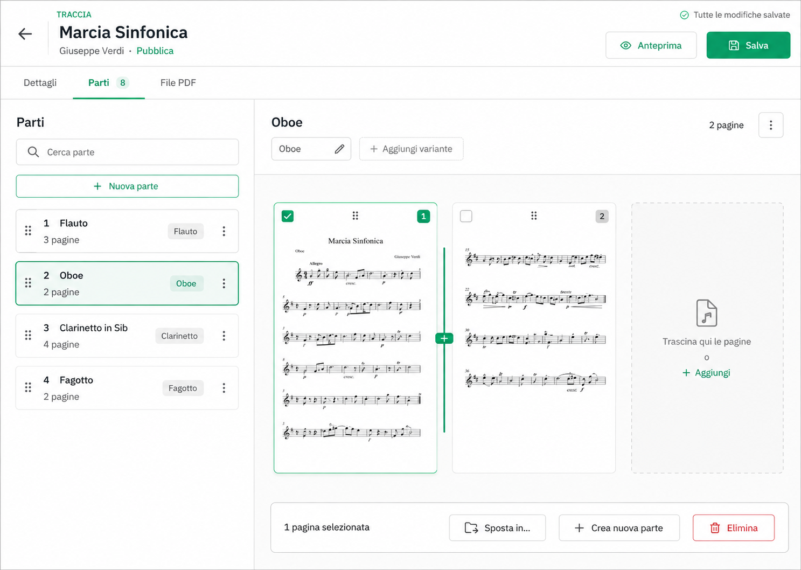

# Gestione delle parti di una traccia

**SPECIFICA UX E TECNICA**

Workspace a due pannelli per organizzare strumenti e pagine degli spartiti

| Voce | Valore |
| --- | --- |
| Prodotto | Taurus frontend |
| Versione | 1.1 |
| Data | 9 settembre 2026 |

## Stato del documento

ID catalogo: `track-parts-workspace`.
Lo stato corrente è pubblicato nel [Catalogo funzionalità](features.md).

## Decisione

La gestione delle parti usa un workspace master detail al posto della tabella con dialog separato. L’elenco delle parti resta visibile a sinistra; la parte selezionata, i suoi strumenti e le relative pagine occupano il pannello principale. Le modifiche avvengono nel contesto e le pagine possono essere riordinate o spostate direttamente.

Il workspace mantiene il salvataggio esplicito della traccia e il contratto di upload PDF esistente. L’interfaccia distingue in modo netto la bozza locale dall’elaborazione asincrona del PDF.

## 1 Sintesi e obiettivi

Questa specifica definisce il comportamento, la struttura visuale e i vincoli tecnici del nuovo workspace Parti. È destinata a chi progetta, implementa e verifica il frontend Angular e le eventuali estensioni del backend Spring Boot.

### Obiettivi

- Rendere visibili le pagine dello spartito senza aprire popover o gallerie separate.
- Consentire riordino, spostamento, unione e divisione senza perdere il contesto della traccia.
- Ridurre i passaggi necessari per assegnare o correggere gli strumenti.
- Esplicitare quali modifiche sono locali e quando diventano persistenti.
- Mantenere il flusso utilizzabile con tastiera, touch e viewport ridotte.

### Problemi del flusso attuale

| Problema | Effetto sull’utente | Risposta progettuale |
| --- | --- | --- |
| Tabella paginata | Le parti sono separate dal loro contenuto visuale e il riordino attraversa una vista filtrabile e paginata. | Elenco persistente senza paginazione client e dettaglio della parte selezionata. |
| Modifica in dialog | Per cambiare strumenti o pagine si perde la vista delle altre parti. | Editor inline nel pannello di destra. |
| Anteprime come icone | È necessario aprire un’altra superficie per riconoscere una pagina. | Miniature leggibili nel workspace. |
| Azioni massive distanti | Selezione e risultato di unione o eliminazione sono difficili da prevedere. | Barra contestuale vicino al contenuto selezionato. |
| Salvataggi diversi | Upload immediato e riordino in bozza comunicano stati differenti nello stesso schermo. | Stati e messaggi separati per job PDF e bozza della traccia. |

### Metriche di successo

- Una parte può essere selezionata e compresa senza aprire un dialog.
- Una pagina può essere spostata in un’altra parte con un’unica azione diretta oppure con un comando da tastiera.
- Ogni modifica comunica immediatamente se è in bozza, salvata o non riuscita.
- Le operazioni principali restano disponibili fino ad almeno 200 parti e 1 000 pagine senza introdurre paginazione nel workspace.

## 2 Direzione visuale

Il mockup seguente rappresenta la direzione approvata. Non fissa dimensioni definitive o dettagli grafici, ma costituisce il riferimento per gerarchia, distribuzione delle funzioni e modello di interazione.

*Figura 1  Workspace Parti a due pannelli*

### Gerarchia della pagina

1. Intestazione della traccia con navigazione indietro, titolo, metadati, anteprima e salvataggio.
2. Navigazione interna tra Dettagli, Parti, Ascolto e File PDF. Il conteggio delle parti è visibile nella scheda.
3. Pannello sinistro per ricerca, creazione, selezione e riordino delle parti.
4. Pannello destro per strumenti, pagine, selezione e azioni contestuali.
5. Tag «Modifiche non salvate» nell'intestazione finché esiste una bozza, indipendente dallo stato dei job PDF.

## 3 Architettura dell’interfaccia

### Navigazione interna

Il dettaglio della traccia usa le schede Dettagli e Parti per tutti i ruoli autorizzati alla consultazione. Ascolto compare quando il tenant ha la funzione di ascolto delle partiture. File PDF è visibile esclusivamente a super amministratori, amministratori e archivisti, che possono contribuire all’arricchimento della traccia. Le schede non diventano nuove route nel primo rilascio; lo stato attivo può essere rappresentato nel query parameter per consentire refresh e collegamenti diretti. Un ruolo non autorizzato che apre un collegamento con `tab=pdf` resta su Dettagli e non avvia il caricamento dei job PDF. La scheda attiva cambia solo per scelta dell'utente o tramite `tab`.

### Pannello delle parti

| Elemento | Comportamento |
| --- | --- |
| Ricerca | Filtra per nome descrittivo e nomi degli strumenti. Non cambia l’ordine persistito. |
| Nuova parte | Crea una parte vuota dopo l’ultima parte e la seleziona immediatamente. |
| Riga parte | Mostra ordine, descrizione sintetica, strumenti e numero di pagine. |
| Selezione | Una sola parte attiva determina il contenuto del pannello destro. |
| Seleziona parti | Attiva la selezione multipla. La barra contestuale resta visibile per tutta la modalità, anche senza parti selezionate, così la casella Seleziona tutte è sempre raggiungibile; i comandi che richiedono una selezione sono disabilitati. |
| Seleziona tutte | La casella della barra contestuale aggiunge alla selezione le parti visibili, cioè quelle che superano la ricerca; deselezionandola la selezione si azzera per intero, comprese le parti nascoste dal filtro. È l’unico comando di selezione della barra: un pulsante Deseleziona separato ripeteva la stessa azione. |
| Riordino | Trascinamento tramite maniglia o pulsanti Sposta parte su e giù; durante la ricerca il riordino è disabilitato per evitare risultati ambigui. |
| Azioni sulla parte | Pulsanti Duplica, Una parte per pagina ed Elimina parte nell’intestazione dell’editor della parte selezionata. Divisione ed eliminazione richiedono conferma; la duplicazione no. |

La ricerca occupa sempre tutta la larghezza utile del pannello. Il wrapper e l’input non possono adottare una larghezza intrinseca né cambiare dimensione dopo focus, digitazione o azzeramento del filtro.

### Pannello della parte selezionata

- Il titolo deriva dalla descrizione della parte; se assente, usa il primo strumento o Parte senza nome.
- Gli strumenti sono modificabili con selezione multipla filtrabile e visualizzazione a chip. Il controllo di ricerca e assegnazione è fluido e occupa sempre tutta la larghezza della propria colonna, prima e dopo l’interazione.
- Le miniature mantengono il rapporto della pagina, riportano ordine e stato di selezione e aprono l’anteprima ingrandita tramite pulsante esplicito, Invio o doppio clic.
- Il trascinamento di una pagina non mostra spazi di inserimento: il rilascio su una card inserisce le pagine in quella posizione, il rilascio sul pannello le accoda.
- Non esiste una zona Aggiungi: nuove pagine arrivano da un PDF caricato nella scheda File PDF oppure da altre parti con Sposta in.

### Allineamento al sistema visuale

- Schede e pannello attivo costituiscono una singola zona visuale, con bordi allineati e senza fasce laterali o inferiori prodotte da overflow o padding esterni.
- Card, campi e pannelli usano raggi, bordi e colori semantici del tema; nessun colore di superficie viene fissato per il solo tema chiaro.
- La separazione verticale tra zone segue il contenitore strutturale con `gap: 2rem`, come definito nel [Taurus Layout Standard](taurus-layout-standard.md); le card non introducono margini esterni propri.
- I controlli destinati a occupare una colonna sono fluidi dal primo rendering e mantengono la stessa larghezza dopo focus, ricerca, selezione o aggiornamento del modello.

### Dimensioni e densità

Il workspace privilegia la leggibilità delle pagine senza sacrificare la scansione dell’elenco. Le soglie seguenti guidano il prototipo responsive e potranno essere affinate con test su dati reali.

| Regola | Desktop | Tablet |
| --- | --- | --- |
| Rapporto pannelli | 34 per cento e 66 per cento | 40 per cento e 60 per cento |
| Larghezza minima elenco | 280 px | 260 px |
| Miniatura | 220 a 280 px di larghezza | 180 a 220 px |
| Area scroll | Scroll principale condiviso; elenco parti sticky con scroll interno solo se supera la viewport | Scroll principale condiviso |
| Barra contestuale | Fissata al fondo del pannello destro | Fissata al fondo della viewport |

## 4 Modello di interazione

### Selezionare e modificare una parte

1. L’utente seleziona una riga nel pannello sinistro.
2. Il pannello destro mostra strumenti e pagine della parte e imposta la prima pagina come riferimento del navigatore.
3. Una modifica agli strumenti aggiorna immediatamente la bozza locale e attiva Salva.
4. Il passaggio a un’altra parte non chiude un dialog e non perde la modifica.

### Verificare una parte

1. Una parte con strumenti assegnati in automatico dall’elaborazione del PDF arriva con `needsReview` vero: l’elenco mostra l’icona Parte da verificare e il pannello destro un avviso ambra.
2. L’utente controlla strumenti, descrizione e pagine e li corregge come una modifica qualsiasi.
3. Segna come verificata porta `needsReview` a falso nella bozza locale, entra nella cronologia come le altre operazioni e attiva Salva; il flag torna vero con Annulla ultima operazione.
4. Dopo un import con molte parti marcate, la modalità Seleziona parti offre Segna come verificate sulla selezione: la casella della barra contestuale seleziona tutte le parti visibili e il comando azzera il flag in un’unica operazione, con conferma che riporta quante parti riguarda. La barra non ha altri comandi oltre a questo, Unisci parti e la casella stessa. Il comando è disabilitato se nessuna parte selezionata è da verificare e non tocca le parti già verificate.
5. Il flag resta vero finché la traccia non viene salvata: correggere gli strumenti non lo azzera da solo, perché la conferma è una decisione dell’utente.
6. In sola lettura l’avviso è informativo e i comandi non compaiono.

### Navigare e consultare le pagine

- Sopra la griglia, quando sono presenti almeno due pagine, compaiono i comandi Pagina precedente e Pagina successiva con l’indicazione Pagina x di n.
- L’attivazione di un comando aggiorna la pagina corrente, porta la card nella porzione visibile e le assegna il focus.
- Il media della pagina si apre dal pulsante Apri anteprima, con doppio clic sulla card o con Invio quando la card ha il focus.
- La pagina corrente e le pagine selezionate hanno stati distinti: navigare non seleziona e selezionare non apre automaticamente l’anteprima.
- Le frecce presenti nel piede della card sono esclusivamente comandi di riordino. Etichetta accessibile e tooltip usano il verbo Riordina per non confonderle con il navigatore.
- La griglia non usa paginazione client: tutte le pagine restano raggiungibili tramite lo scroll principale e i comandi di navigazione.

### Riordinare le pagine

Il trascinamento parte solo dalla maniglia della miniatura; in alternativa si usano i pulsanti Riordina o Ctrl più frecce. Al rilascio rinumera le pagine della parte da 1 a n e mantiene selezionata la pagina spostata.

### Spostare pagine tra parti

| Modalità | Sequenza | Esito |
| --- | --- | --- |
| Trascinamento | Il trascinamento agisce solo nella parte selezionata e riordina le sue pagine. | Lo spostamento tra parti usa la barra contestuale. |
| Barra contestuale | Selezionare le pagine, scegliere la destinazione in Sposta in e premere Sposta. | Le pagine vengono accodate nella parte di destinazione, che diventa la parte selezionata. |

La barra delle pagine compare con almeno una pagina selezionata, accanto al titolo Pagine e centrata verticalmente su di esso. Come nella barra delle parti, la casella seleziona tutte le pagine della parte e, deselezionata, azzera la selezione e la destinazione scelta in Sposta in; non c’è un pulsante Deseleziona separato.
| Nuova parte | Selezionare le pagine e scegliere Nuova parte. | Nasce una parte dopo quella corrente, con strumenti vuoti e pagine nell’ordine della parte sorgente. |

### Unire parti

L’unione resta un’azione sulle parti, non sulle pagine. Dopo l’attivazione della modalità Seleziona parti, la barra contestuale mostra il numero di parti, l’ordine di concatenazione e l’azione Unisci. Il risultato usa la posizione della prima parte, concatena le pagine nell’ordine delle parti e rimuove duplicati dagli strumenti mantenendo il primo ordine incontrato.

### Dividere una parte

La divisione ha due comandi: Una parte per pagina, nell’intestazione dell’editor, e Dividi qui, nella barra contestuale, che divide dopo la pagina selezionata. La conferma descrive il risultato e gli strumenti restano in tutte le parti create.

### Annullare

Il primo rilascio offre Annulla ultima operazione per riordino, spostamento, unione, divisione, verifica ed eliminazione non ancora salvati. È sufficiente una cronologia locale lineare della sessione; dopo Salva la cronologia viene azzerata. La conferma distruttiva resta necessaria per eliminare pagine o parti.

### Regole trasversali

- Dopo ogni operazione gli ordini restano continui e partono da 1.
- La selezione segue pagine e parti spostate, anche quando cambia il contenitore.
- Una parte svuotata non viene eliminata automaticamente: resta disponibile per ricevere nuove pagine.
- Un’operazione non valida non modifica la bozza e spiega come correggere la selezione.
- Ogni esito è annunciato visivamente e attraverso la regione aria live del workspace.

## 5 Stati e salvataggio

### Stati della bozza

| Stato | Indicatore | Azioni |
| --- | --- | --- |
| Sincronizzata | Nessun indicatore | Salva disabilitato |
| Modificata | Tag Modifiche non salvate | Salva e Annulla ultima operazione disponibili |
| Salvataggio | Pulsante Salva traccia in caricamento | Annulla ultima operazione e Modifica immagine disabilitati |
| Errore | Banner Modifiche non salvate con dettaglio recuperabile | Riprova; la bozza resta in memoria |

### Stati del PDF

I job PDF mantengono la semantica definita dalla specifica di elaborazione asincrona: In coda, Elaborazione in corso, Completato ed Elaborazione non riuscita. Questi stati vivono nella scheda File PDF e non sostituiscono l’indicatore della bozza.

| Evento | Comportamento del workspace |
| --- | --- |
| Upload accettato | Mostrare il job nella scheda File PDF. Non alterare la bozza Parti. |
| Job completato prima dell’apertura | La successiva lettura della traccia include le nuove parti e le presenta normalmente. |
| Job completato mentre esiste una bozza | La traccia non viene ricaricata e, senza polling, il completamento non è rilevato. Le nuove parti compaiono alla lettura successiva; il salvataggio della bozza può ricevere `409` se il worker ha cambiato la versione della traccia. |
| Retry del job | Aggiornare lo stato locale del job a In coda senza polling. |

### Protezione da perdita dati

- La guardia di navigazione esistente protegge uscita, cambio route e chiusura con bozza modificata.
- Il cambio di scheda interno non scarta la bozza.
- Il refresh e la chiusura della scheda del browser non chiedono conferma.
- Una risposta di salvataggio aggiorna la traccia locale con la versione restituita dal server.

### Concorrenza

Il payload aggiorna l’intera traccia e porta la sua `version`. Il backend usa il controllo ottimistico: una versione non corrente restituisce `409` `version.conflict`. Il frontend mostra il banner Modifiche non salvate con Riprova, senza confronto tra bozza e dati server.

## 6 Stati visuali e messaggi

| Caso | Presentazione | Azione primaria |
| --- | --- | --- |
| Nessuna parte | Stato vuoto Nessuna parte: carica un PDF dalla scheda File PDF oppure crea una parte vuota. | Nuova parte |
| Parte senza pagine | Stato vuoto Nessuna pagina: sposta pagine da un’altra parte oppure carica un PDF. | Nessuna |
| Parte senza strumenti | Testo Strumento mancante nell’elenco; tag ambra in sola lettura. | Assegna strumenti |
| Parte con strumenti suggeriti | Icona Parte da verificare nell’elenco e avviso ambra nel pannello della parte; in sola lettura l’avviso resta senza azione. | Segna come verificata |
| Miniatura in caricamento | Skeleton con rapporto pagina e nome accessibile. | Nessuna |
| Miniatura non disponibile | Segnaposto Anteprima non disponibile. | Riprova |
| Ricerca senza risultati | Nessuna parte corrisponde alla ricerca. | Azzera ricerca |
| Operazione non valida | Comando disabilitato oppure messaggio nella regione aria live; nessuna modifica alla bozza. | Correggi selezione |
| Salvataggio fallito | Banner non modale; selezione e scroll restano invariati. | Riprova |

### Testi principali

| Contesto | Testo |
| --- | --- |
| Titolo scheda | Parti |
| Ricerca | Cerca per parte o strumento |
| Creazione | Nuova parte |
| Parte senza pagine | Nessuna pagina |
| Bozza modificata | Modifiche non salvate |
| Spostamento | Sposta in |
| Parte incompleta | Strumento mancante |
| Parte da revisionare | Parte da verificare |
| Avviso della parte da verificare | Gli strumenti sono stati assegnati in automatico dal PDF. Controllali, correggili se servono e segna la parte come verificata. |
| Conferma della verifica | Segna come verificata |
| Verifica massiva | Segna come verificate |
| Conferma della verifica massiva | N parti non saranno più segnalate come da verificare. Potrai annullare l’operazione prima del salvataggio. |
| Conferma unione | Le pagine saranno concatenate nell’ordine delle parti selezionate. Gli strumenti duplicati verranno rimossi. |

### Regole editoriali

- Usare parte per il raggruppamento logico e pagina per il singolo media dello spartito.
- Usare sposta per il trasferimento e riordina per un cambio di posizione nello stesso contenitore.
- Descrivere il risultato delle conferme, non soltanto il comando.
- Non affidare mai stato o gravità al solo colore.

## 7 Responsive e accessibilità

### Comportamento responsive

| Viewport | Composizione |
| --- | --- |
| Da 1024 px | Due pannelli affiancati con proporzione fissa. |
| Da 768 a 1023 px | Due pannelli più compatti. Miniature su due colonne; azioni secondarie nel menu overflow. |
| Sotto 768 px | Navigazione a due livelli: elenco Parti e dettaglio della parte. Il dettaglio si apre come pagina interna con pulsante Indietro alle parti. |
| Touch | Nessuna funzione dipende dal trascinamento. Selezione e menu Sposta in coprono lo stesso flusso. |

### Tastiera

| Tasto | Risultato |
| --- | --- |
| Frecce direzionali | Nella griglia, sinistra e su vanno alla pagina precedente; destra e giù alla successiva. Nell’elenco delle parti il focus si sposta con Tab. |
| Invio | Apre la parte o l’anteprima della pagina focalizzata. |
| Spazio | Seleziona o deseleziona la pagina. |
| Ctrl più frecce | Riordina la parte focalizzata con su e giù, la pagina focalizzata con sinistra e destra. |
| Escape | Nessuna gestione dedicata nel workspace; valgono i comportamenti nativi del browser e di PrimeNG. |

### Requisiti accessibili

- Ogni pannello possiede titolo programmatico e landmark coerente.
- La parte attiva espone aria current o aria selected; il conteggio pagine fa parte del nome accessibile.
- Le miniature hanno testo alternativo composto da parte, numero pagina e nome media quando disponibile.
- Il pulsante di anteprima espone il numero della pagina nel nome accessibile; il navigatore annuncia Pagina x di n.
- Gli aggiornamenti di ordine e destinazione sono annunciati con regione aria live educata.
- Maniglie e pulsanti a sola icona hanno etichette esplicite e area attiva minima di 44 per 44 px.
- Focus, selezione, errore e destinazione di drop superano il contrasto minimo e non usano il solo colore.
- Dopo un’operazione il focus segue l’oggetto, non torna all’inizio della pagina.

## 8 Progettazione tecnica

### Componenti frontend

| Componente | Responsabilità | Tecnologia suggerita |
| --- | --- | --- |
| Track detail shell | Intestazione, schede, dirty state e salvataggio. | Componenti condivisi esistenti e PrimeNG Tabs |
| Score workspace | Coordinamento di selezione, filtri, drag and drop e cronologia locale. | Nuovo componente standalone |
| Score list | Elenco parti, ricerca e riordino. | Markup semantico custom con DragDrop |
| Score editor | Strumenti, pagine e azioni della parte selezionata. | MultiSelect o AutoComplete multiple e componenti custom |
| Media thumbnail | Anteprima, selezione, caricamento ed errore. | Componente OnPush riutilizzabile |
| Selection bar | Azioni contestuali sulle pagine o sulle parti. | Estensione del componente condiviso esistente, con l’ingresso `alwaysVisible` per la modalità di selezione delle parti |

### Stato locale

Il workspace lavora su una copia normalizzata di track.scores. Una parte persistita usa come chiave il proprio `id`; una parte in bozza usa una chiave derivata dall’ordine. Le pagine usano l’id del media. Il modello espone `needsReview`, mostrato nell’elenco con l’icona Parte da verificare e azzerabile dal pannello della parte con Segna come verificata. Al salvataggio il backend conserva l’identità delle parti con `id`.

| Stato | Tipo suggerito | Nota |
| --- | --- | --- |
| selectedScoreKey | string o number | Identità stabile, non ordine visuale |
| selectedMediaKeys | Set number | Indici media selezionati |
| draftScores | SheetsMusic array | Copia ordinata e modificabile |
| undoStack | WorkspaceOperation array | Cronologia lineare della sessione |
| filterQuery | string | Disabilita riordino parti se non vuota |
| activePageIndex | number | Pagina corrente del navigatore; viene limitata all’intervallo disponibile |
| saveState | clean dirty saving error | Fonte unica per feedback e comandi |

### Contratto dati

- Il salvataggio invia l’intero TracksDTO con scores ordinati.
- Il modello TypeScript di SheetsMusic include `id` e `needsReview`.
- Il frontend normalizza order delle parti, dei media e degli strumenti prima dell’invio; il backend lo rinormalizza.
- Endpoint specifici per spostamento e riordino vanno valutati solo se dimensione payload, audit o concorrenza lo richiedono.
- La `version` della traccia e la risposta `409` impediscono sovrascritture silenziose.
- Mantenere mutabili le collezioni JPA assegnate a `Tracks.scores`, `SheetsMusic.media` e `SheetsMusic.instruments`. Non usare `List.of` o `Stream.toList` quando la raccolta diventa stato dell’entità, perché Hibernate deve poterla aggiornare durante `merge` e `flush`.

### Prestazioni

- Le miniature si caricano quando entrano nella vista (`IntersectionObserver`); il media a piena risoluzione serve solo all’anteprima.
- Usare trackBy basato su chiavi stabili e ChangeDetectionStrategy OnPush nei componenti di lista e miniatura.
- L’elenco delle parti non è virtualizzato; evitare la virtualizzazione orizzontale delle pagine finché non è misurata una necessità reale.
- Rilasciare gli object URL o le sottoscrizioni quando una miniatura esce definitivamente dalla vista.

## 9 Verifica

### Strategia di test

| Livello | Copertura minima |
| --- | --- |
| Unità | Riduttore delle operazioni, rinumerazione, unione strumenti, split, undo, selezione e filtro. |
| Componenti | Focus, navigazione tra pagine, apertura anteprima da pulsante e tastiera, annunci aria live, menu, stati vuoti, errore miniature, larghezza fluida dei controlli, dirty state e permessi. |
| Integrazione frontend | Caricamento traccia, salvataggio, errore e retry, job PDF già esistenti e refresh. |
| Backend | Normalizzazione ordini, controllo versione, tenant isolation, payload non valido e mutabilità delle collezioni persistenti durante merge e flush. |
| End to end | Flussi completi con mouse, tastiera e viewport mobile; almeno un PDF con parti da revisionare. |
| Prestazioni | 200 parti e 1 000 pagine; interazione fluida, richieste miniature controllate e memoria stabile. |

### Telemetria consigliata

Il workspace non registra telemetria. La misura prevista, senza registrare contenuti musicali o nomi dei file, riguarda apertura della scheda Parti, uso di ricerca, riordino, spostamento, unione, divisione, annullamento ed errori di salvataggio. Vanno confrontati il tempo dalla prima apertura al salvataggio e il numero di operazioni per sessione.

## 10 Criteri di accettazione

1. La scheda Parti mostra sempre elenco e dettaglio della parte selezionata su desktop.
2. La selezione di una parte non apre dialog e non modifica l’ordine.
3. Strumenti e descrizione possono essere modificati inline con stato dirty coerente.
4. Le miniature mostrano ordine, selezione, caricamento, errore e anteprima accessibile.
5. Una o più pagine possono essere riordinate e spostate tramite trascinamento e tramite comando equivalente.
6. Unione, divisione ed eliminazione descrivono il risultato prima della conferma e possono essere annullate finché la bozza non viene salvata.
7. Il riordino delle parti è disabilitato durante una ricerca attiva e il motivo è comunicato.
8. Il salvataggio rinumera parti, media e strumenti e usa la risposta server come nuovo stato sincronizzato.
9. Upload e retry dei PDF rispettano la specifica asincrona esistente senza polling aggiuntivo.
10. Una bozza non viene sovrascritta automaticamente quando diventano disponibili nuove parti da un job PDF.
11. Sotto 768 px il dettaglio della parte diventa una vista dedicata con ritorno all’elenco.
12. Tutte le funzioni sono disponibili da tastiera e non dipendono dal solo colore o dal trascinamento.
13. I ruoli di sola lettura vedono la stessa struttura senza controlli di modifica e possono aprire le anteprime.
14. I test automatizzati coprono operazioni, permessi, dirty state, errori, concorrenza e tenant isolation.
15. Tutte le pagine restano raggiungibili senza un’area del pannello destro troncata; il navigatore porta la card richiesta in vista e aggiorna Pagina x di n.
16. L’anteprima di ogni media si apre tramite pulsante, doppio clic e Invio; i comandi di navigazione e riordino restano semanticamente distinti.
17. I campi Cerca per parte o strumento e Cerca e assegna strumenti occupano tutta la larghezza disponibile fin dal primo rendering e non cambiano larghezza dopo l’interazione.
18. Il workspace mantiene bordi, separazioni e superfici coerenti in tema chiaro e scuro, senza disallineamenti tra intestazione delle schede e corpo.
19. File PDF è assente per utenti e utenti esterni; un collegamento diretto alla scheda non mostra contenuti vuoti e non carica i job PDF.

### Fuori ambito

- Riconoscimento automatico aggiuntivo di strumenti o struttura musicale.
- Collaborazione in tempo reale tra più archivisti.
- Polling, WebSocket o Server Sent Events per i job PDF.
- Annotazione o modifica grafica della pagina nel workspace Parti; l'estensione dedicata è definita in [Modifica e analisi delle immagini delle parti](track-page-image-editing-spec.md).
- Sostituzione del visualizzatore e del flusso di stampa esistenti.

### Decisioni adottate

| Decisione | Esito |
| --- | --- |
| Identità stabile della parte | `id` nel DTO e nel modello frontend; order non è usato come chiave delle parti persistite. |
| Conflitti di salvataggio | `version` della traccia e controllo ottimistico. |
| Aggiunta manuale di pagine | Limitata allo spostamento di media già presenti; estensioni solo con contratto esplicito. |
| Undo | Cronologia locale fino al salvataggio, senza persistenza tra refresh. |
| Dividi | Divisione dopo la pagina selezionata e una parte per pagina. |

## Requisiti aperti

- Banner Nuove parti disponibili con Ricarica e continua oppure Salva prima; senza polling va riprogettato (5 Stati del PDF; criterio 10).
- Confronto tra bozza e dati server dopo un `409` (5 Concorrenza).
- Conferma prima di refresh o chiusura della scheda del browser con bozza modificata (5 Protezione da perdita dati).
- Indicatore Tutte le modifiche salvate per la bozza sincronizzata (2 Gerarchia della pagina; 5 Stati della bozza).
- Zona Aggiungi e drop zone per le parti senza pagine (3 Pannello della parte selezionata; 6 Stati visuali e messaggi).
- Trascinamento di pagine tra parti, con spazi di inserimento e indicatore di posizione (4 Riordinare le pagine; 4 Spostare pagine tra parti; criterio 5).
- Selezione automatica della scheda Parti dopo un’azione di organizzazione (3 Navigazione interna).
- Tastiera: frecce sull’elenco parti, Maiusc più frecce per la selezione contigua, Escape gestito dal workspace (7 Tastiera; criterio 12).
- Divisore ridimensionabile tra i pannelli (7 Comportamento responsive).
- Virtualizzazione dell’elenco parti per raccolte molto grandi (8 Prestazioni).
- Telemetria UX (9 Telemetria consigliata).
- Gate end to end e prestazionali con 200 parti e 1 000 pagine (9 Strategia di test).
